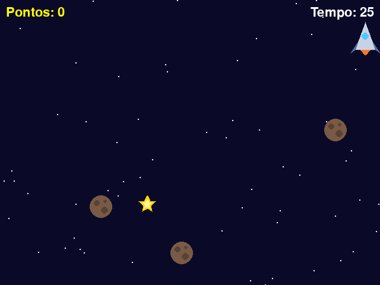

# Portfólio Python — Abner Duarte

Jogos e scripts feitos com **Python**, com código simples e comentado em português, pensados para quem está aprendendo.

## Jogos em Pygame Zero

| [Coletor de Estrelas](coletor-de-estrelas/) | [Chuva de Frutas](chuva-de-frutas/) |
|---|---|
|  |  |
| Pilote a nave, pegue estrelas antes do tempo acabar e fuja dos meteoros. Menu com botões, combo, bônus de tempo, partículas, sons e recorde salvo. | Pegue as frutas com a cesta e desvie das bombas. Vidas, níveis, estrela dourada e suco espirrando. Escrito sem classes, só com listas, dicionários e funções. |

## Scripts em Python puro

[**scripts-python/**](scripts-python/): três programas de terminal usando só o básico da linguagem e módulos nativos. Também estão no repositório [Desafios-Dev](https://github.com/Abner-Duarte/Desafios-Dev).

| Script | O que faz |
|---|---|
| [`estoque.py`](scripts-python/estoque.py) | Menu de estoque com entrada, saída, histórico e validação de tudo o que o usuário digita |
| [`comissao.py`](scripts-python/comissao.py) | Lê vendas de um JSON e monta a tabela de comissão por vendedor |
| [`juros.py`](scripts-python/juros.py) | Calcula juros de um título atrasado a partir da data de vencimento |

## Como rodar

```bash
pip install pgzero
cd coletor-de-estrelas
pgzrun coletor.py
```

O `pgzrun` precisa ser rodado de dentro da pasta do jogo, porque as imagens e os sons são lidos de lá.

> No Python 3.14, o `pygame` ainda não tem instalador pronto. Nesse caso, use:
> `pip install pygame-ce numpy` e depois `pip install --no-deps pgzero`.

Os scripts não precisam de nada instalado:

```bash
cd scripts-python
python estoque.py
```
