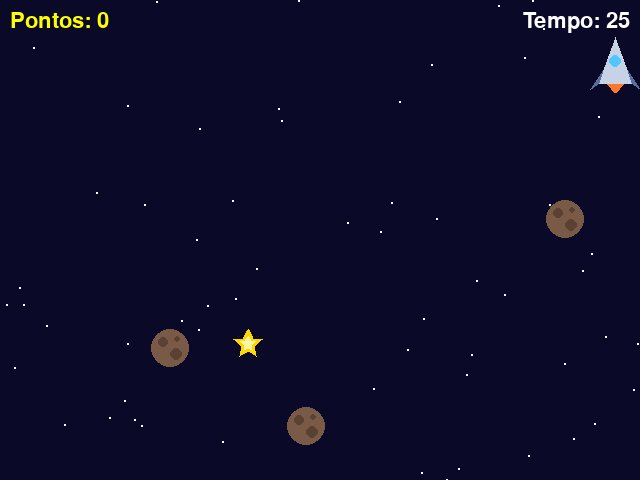

# Coletor de Estrelas



Pilote a nave com as **setas** e pegue o máximo de estrelas em **30 segundos**.
Cuidado com os meteoros: cada batida tira **3 segundos** do relógio, e a nave fica piscando, protegida, por um instante.
No fim, aperte **ESPAÇO** para jogar de novo.

## Como rodar

```bash
pip install pgzero
pgzrun coletor.py
```

## O que o código usa

| Conceito | Onde |
|---|---|
| Variáveis | `pontos`, `tempo`, `fim_de_jogo` |
| Condicionais (`if`) | `mover_nave()`: só move se a seta estiver apertada e a nave não estiver na borda |
| Laço (`for`) | `update()`: cada meteoro da lista anda para a esquerda |
| Funções | `mudar_estrela_de_lugar()`, `criar_meteoro()`, `comecar_jogo()` |
| Listas | `meteoros` e os pontinhos do `fundo` |
| Colisão | `nave.colliderect(estrela)` |
| Tempo | `clock.schedule_interval` conta um segundo de cada vez |
